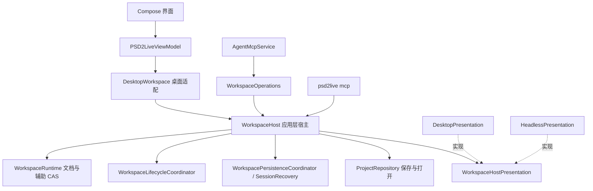

# 无窗口宿主

[文档目录](../../README.md) · [智能体设计](../agent/AGENT_DESIGN.md) · [MCP 编写操作](../agent/MCP_AUTHORING.md) · [素材与 Layout](MATERIAL_LAYOUT_WORKSPACE.md)

工作区的应用逻辑在不依赖界面的 `application.WorkspaceHost` 中，桌面编辑器与无窗口 MCP（`psd2live mcp`）是它的两个宿主：编辑器把结果投影进 Compose 状态，无窗口宿主不显示任何东西。本页记录结构、两个宿主的差别与验收；"已实现"与"待做"分开列出。

## 为什么需要无窗口宿主

无窗口模式是智能体与外部生成工具协作的主通道：外部工具（图像生成、抠图、分割）只产出像素，裁特写、摆放、纹理密度、分类、生成 Rig、检查姿态和导出都在 PSD2Live 内完成。参见 [素材与 Layout](MATERIAL_LAYOUT_WORKSPACE.md) 的"按参考图拆件"与"剥离"：特写按画布矩形放回时不重采样，部件的清晰度就是特写的放大倍数，这一点只有在程序内排版才能保证。

此前 `psd2live mcp` 把桌面应用的 `PSD2LiveViewModel` 与 `DesktopWorkspace` 原样建起来、只是不显示窗口：提交要经过界面副本的二次 CAS，忙碌与未保存读界面字段，生命周期挂在 ViewModel 上，动作采样等主窗口的 GPU 上下文而超时。

## 结构（已实现）

- **`WorkspaceHost<V>`**（`application/WorkspaceHost.kt`）实现 `WorkspaceBackend`：持有运行时、全部命令对象、草稿队列、持久化与恢复检查点（`SessionRecovery`）、工程归档的打开与保存（原 `ProjectController`）。`V` 是宿主自己的展示快照类型，操作开始时捕获，通知时交回，宿主据此判断展示是否已经变化。
- **`WorkspaceHostPresentation<V>`**（`application/WorkspaceHostPresentation.kt`）是宿主看到的全部界面：
  - 读：`current` / `withCurrent`、`facts`（忙碌、未保存、当前工作区、画布地址、展示字段，见 `WorkspaceHostFacts`）、`document`（展示持有的文档副本，无则为 null）、`visibleLayers`、`auxiliary`、`config`、`basis`；
  - 投影：`project`（提交内把结果投影进展示，返回 false 拒绝提交），以及历史、模型、姿态、播放帧、摆动与模拟预览、画布可见性、导入与安装、保存进度等通知；
  - 归档展示：`encode` / `decode` 把展示部分（布局、镜头、画布）与归档 JSON 互转；
  - 其他：`simulationBake`、`sampleMotion`、`importedSource`（编辑器自行分析的 PSD）。
- **`DesktopWorkspace`** 是编辑器的薄适配：用 `DesktopPresentation` 包装 ViewModel 构造宿主，转发编辑器与测试需要的内部入口。编辑器保留自己的文档副本，`project` 仍对它做二次 CAS，行为与重构前一致。
- **`HeadlessPresentation`** 是无窗口展示：不持有文档副本，`project` 恒为 true，通知全部为空；只记录查询要报告的工程 ID、来源、保存路径，未保存取运行时的 `hasUnsavedChanges`；归档中的展示 JSON 原样往返；动作采样用不依赖窗口的 Cubism 会话（`CubismSdkPreviewSession.windowless`，`ThreadGpuExecutor`）。
- **`psd2live mcp`**（`HeadlessMcp`）设 `java.awt.headless=true`，构造 `WorkspaceHost(HeadlessPresentation)` + `WorkspaceOperations` + `AgentMcpService`，不创建 ViewModel、Compose 状态或窗口。一个进程一个工程，需要并行时起多个进程，各用自己的 `--store`。启动时除 `endpoint`、`token`、`profile`、`store` 外打印 `capabilities`，目前为 `view_sample_motion=yes|no`（构建是否带 Cubism Core）。

### 两个宿主的差别

| 方面 | 桌面 | 无窗口 |
| --- | --- | --- |
| 文档副本 | 编辑器持有，提交时二次 CAS | 无，运行时文档即展示 |
| 新来源的初始设置 | 编辑器当前设置 | `PipelineConfig()`，与编辑器默认相同（测试固定） |
| 工作区与画布 | 编辑器的标签页与画布 | 固定一个工作区 `main`，无画布 |
| 保存路径 | 生命周期记录或编辑器状态 | 生命周期记录或最近一次保存 / 打开的路径 |
| 动作采样 | 主窗口的 Cubism 会话 | 独立线程的无窗口会话 |
| 进度 | 状态栏 | 进程任务自身的进度 |

## 外部工具的接入方式

外部脚本只做程序做不到的事（调用图像生成服务、外部抠图模型），并且只通过 MCP 与程序交换像素：

1. `material_crop`（`canvas_rect`）截特写 → `material_export_png` 交给外部；
2. 外部输出高分辨率图片 → `material_import` → `material_set_placement`（`from` 特写）→ 逐层 `material_peel` → `layer_place`；
3. 对齐、密度、分类、生成、姿态检查、导出都用程序内的操作。

外部代码因此不再需要自写 PSD、按画布重采样、拼贴合成、自己画对比图。仍在外部的只有生成服务的客户端与工作流（不在主线，见 `comfy-tools` 分支）。脚本用随程序发布的 `mcp_proxy.py`（`Client`，或 `call` / `operations` 命令行模式）调用操作。

## 待做

- **权威完全收归运行时**：编辑器仍持有文档副本，`DesktopPresentation.project` 对它做二次 CAS，保存前把编辑器版本的文档提交进运行时。改为界面只观察运行时（副本只作字段草稿，经 `WorkspaceDraftQueue` 提交）后，可去掉 `document` 与 `project` 的拒绝语义。这一步改变编辑器的提交与保存时机，单独进行。
- **模拟烘焙进度**：无窗口宿主的 `simulationBake` 不报告进度，可接到进程任务的进度与取消。

## 验收

- `LayerDependencyTest`：`application`、`agent`、`project`、`core`、`history` 包与 `HeadlessMcp` 不引用 `ui` 与 Compose。
- `HeadlessHostScenario`：
  - 无窗口宿主经 MCP 完成新建 Layout 工程、导入、参考图、裁特写、放置、标签、生成、带参考差值的渲染、另存、保存、重开与导出；
  - 同一组调用在桌面宿主与无窗口宿主上得到相同的文档修订；
  - 无窗口的默认设置与编辑器默认相同。
- 实测：`psd2live mcp` 进程经 `mcp_proxy.py` 的 `Client` 跑通 Layout 与剥离流程，`view_sample_motion` 在无窗口时约 1 秒返回采样拼图。
- 编辑器场景（`SaveAndCloseTest`、`EditorAndAgentScenario` 等）与全部测试不变通过。
